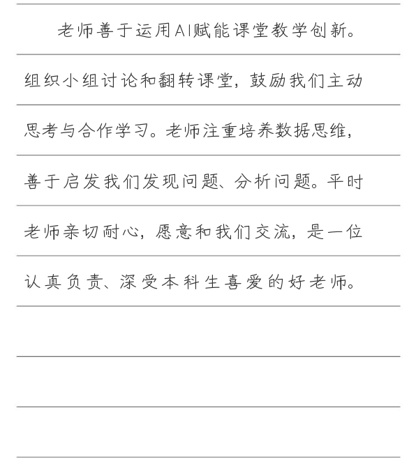

# 横线纸手写评语排版模板

把中文评语排到横线纸图片上，使用手写风格字体，并支持首行缩进、行尾对齐、标点缩小和行距配置。

## 效果预览



## 环境要求

- Python 3.10 或更高版本
- Pillow

安装依赖：

```powershell
python -m pip install -r requirements.txt
```

## 使用方法

准备一个 UTF-8 编码的文本文件，每行对应横线纸上的一行文字。每行文字长度应能放进对应版心；程序会在普通文字之间均匀分配字距，使各行右边缘对齐。文字太长时会报错提醒。

```powershell
python template.py --paper assets/ruled-paper.png --text-file examples/comment.txt --output output/comment.png
```

常用参数：

- `--first-line-indent`：首行额外缩进像素，默认 48 像素，约为默认字号下两个字宽；设为 `0` 可取消缩进。
- `--left` 和 `--right`：正文左右边界坐标，单位为像素。
- `--rules`：横线的 y 坐标列表，用逗号分隔，从上到下填写。
- `--font-size`：正文字号，单位为像素。
- `--ink R G B`：文字颜色。
- `--font`：字体文件路径。

默认横线坐标和正文边界适配本项目的 `assets/ruled-paper.png`。更换纸张图片时，请相应调整 `--rules`、`--left` 和 `--right`。每行文字会在对应两条横线之间垂直居中。

中文逗号、句号、问号、叹号、分号、冒号和顿号会以正文字号约 62% 的大小绘制，并紧靠相邻文字，减少标点显得过大的问题。

## 字体授权

项目附带的简体中文手写风格字体为 YShi-Written，字体授权文件位于 `fonts/OFL.txt`，采用 SIL Open Font License 1.1。字体来源及其保留名称等说明见上游项目：

- https://github.com/Steve-Yuu/YShi-Written

模板代码采用 MIT License，见根目录的 `LICENSE`。字体授权独立于模板代码授权。
